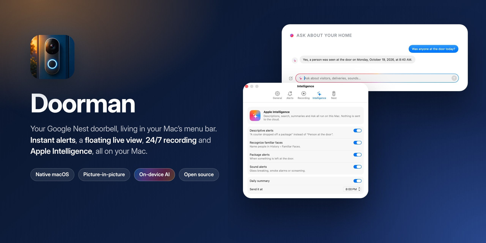
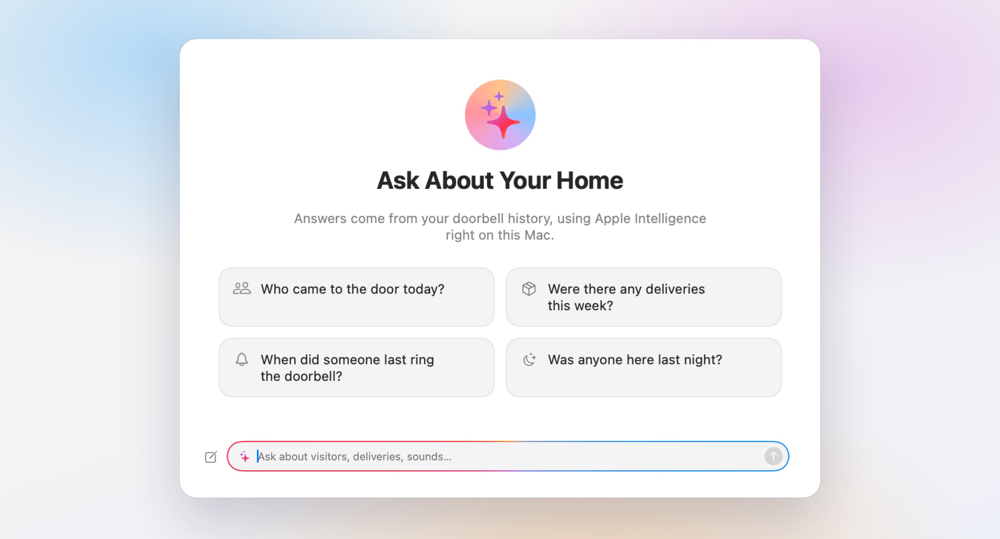
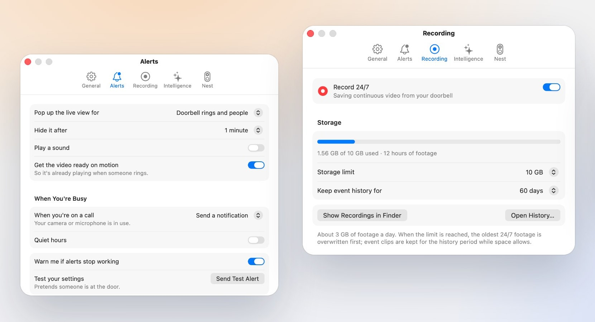
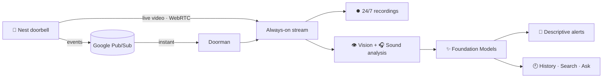

<p align="center">
  
</p>

<p align="center">
  
  
  
  
  
</p>

<p align="center">
  <b>See who's at the door without leaving what you're doing.</b><br>
  A native Mac app for Google Nest doorbells, with instant alerts, a floating live view,<br>
  24/7 recording and Apple Intelligence. All of it runs on your Mac.
</p>

<p align="center">
  <a href="#-features">Features</a> ·
  <a href="#-what-you-need">What you need</a> ·
  <a href="#-setup">Setup</a> ·
  <a href="#-privacy">Privacy</a> ·
  <a href="#-faq">FAQ</a>
</p>

---

## ✨ Features

<table>
<tr>
<td width="33%" valign="top">

### 🔔 Instant alerts
Rings, people, packages and motion arrive the moment they happen, through Google's official Nest API. Busy on a call? The app sends a quiet notification instead of popping up.

</td>
<td width="33%" valign="top">

### 🪟 Floating live view
When someone rings, a picture-in-picture window appears above everything else. It's resizable, follows you across desktops and has glass controls for sound, Talk and snapshots.

</td>
<td width="33%" valign="top">

### ⏺️ 24/7 recording
Every minute is saved to your Mac, up to a storage limit you choose (10 GB is about three days). The oldest footage is replaced first. Scrub through any hour on a timeline.

</td>
</tr>
<tr>
<td valign="top">

### ✨ Descriptive alerts
*"A courier left a package"* instead of *"Motion detected."* Apple Intelligence and Vision describe each visit, right on your Mac.

</td>
<td valign="top">

### 👤 Familiar faces
Name someone once, and alerts, descriptions and search use their name from then on. Face data never leaves your Mac.

</td>
<td valign="top">

### 💬 Ask about your home
*"Were there any deliveries this week?"* Search your history in plain English, get a daily summary, or chat about what happened.

</td>
</tr>
</table>

<p align="center">
  
</p>

It also listens for **sounds** like knocking, barking, breaking glass and smoke alarms, and notices **packages left at the door**. It lives in your **menu bar**, with no Dock icon.

<p align="center">
  
</p>

---

## 🧰 What you need

| | |
|---|---|
| 💻 **A Mac** | Apple Silicon, **macOS 26 (Tahoe) or later**, with **Apple Intelligence** turned on |
| 🛠️ **Apple's free developer tools** | Run `xcode-select --install` in Terminal (about 5 minutes) |
| 🚪 **A Nest doorbell or camera** | Any model that works with Google's [Device Access](https://developers.google.com/nest/device-access/supported-devices) program, set up in the Google Home app |
| 🎟️ **Google Device Access** | A one-time **US$5** registration fee, paid to Google |

> [!NOTE]
> There's no shared server and no subscription. You set up your **own private connection** between your Google account and your Mac. It takes about **30 minutes**, once.

---

## 🚀 Setup

```
 ① Device Access  →  ② Google Cloud  →  ③ Event feed  →  ④ Link them  →  ⑤ Settings file  →  ⑥ Build
     2 min              10 min              3 min            3 min            2 min             2 min
```

### ① Register for Device Access

1. Open the **[Device Access Console](https://console.nest.google.com/device-access)** with the Google account your doorbell is on.
2. Accept the terms and pay the one-time US$5 fee.

> [!IMPORTANT]
> Use a personal Google account (such as @gmail.com). Google Workspace accounts can't register.

### ② Create a Google Cloud project

1. In the **[Google Cloud Console](https://console.cloud.google.com/projectcreate)**, create a project, for example `my-doorbell`. Write down its **project ID**.
2. Turn on two APIs: **[Smart Device Management API](https://console.cloud.google.com/apis/library/smartdevicemanagement.googleapis.com)** and **[Cloud Pub/Sub API](https://console.cloud.google.com/apis/library/pubsub.googleapis.com)**.
3. Set up the **[OAuth consent screen](https://console.cloud.google.com/apis/credentials/consent)**:
   - choose **External** and leave it in **Testing**
   - add your own email under **Test users**
4. Create **[credentials](https://console.cloud.google.com/apis/credentials)**: choose **Create credentials → OAuth client ID → Web application**. Under **Authorized redirect URIs**, add exactly:
   ```
   http://localhost:8765/callback
   ```
   Copy the **Client ID** and **Client secret**. You'll need them in step ⑤.

### ③ Create the event feed

This is how the doorbell tells your Mac that something happened, instantly. Open **[Cloud Shell](https://shell.cloud.google.com/)**, change `my-doorbell` on the first line to your project ID, and paste all of it:

```sh
PROJECT=my-doorbell
gcloud config set project $PROJECT
gcloud pubsub topics create doorbell-events
gcloud pubsub topics add-iam-policy-binding projects/$PROJECT/topics/doorbell-events \
  --member="group:sdm-publisher@googlegroups.com" --role="roles/pubsub.publisher"
gcloud pubsub subscriptions create doorbell-mac --topic=projects/$PROJECT/topics/doorbell-events
```

### ④ Link Google Cloud to your doorbell

1. Back in the **[Device Access Console](https://console.nest.google.com/device-access)**, click **Create project** and paste your OAuth **Client ID**.
2. Choose **Enable events**. For the Pub/Sub topic, enter:
   ```
   projects/my-doorbell/topics/doorbell-events
   ```
3. Copy the project's **Project ID**. It's a long code like `a1b2c3d4-…`, *not* the same as your Cloud project ID.

### ⑤ Fill in your settings

Download the code (green **Code** button → **Download ZIP**), or clone it. Then, in the folder:

```sh
git clone https://github.com/dpappo/doorman.git && cd doorman
cp nest-config.example.json nest-config.json
open -e nest-config.json
```

| Field | What to put there |
|---|---|
| `clientId` · `clientSecret` | From step ② |
| `cloudProjectId` | Your Google Cloud project ID, e.g. `my-doorbell` |
| `subscription` | `projects/my-doorbell/subscriptions/doorbell-mac` |
| `deviceAccessProjectId` | The long ID from step ④ |
| `googleHomeCameraURL` | **Optional.** Open your doorbell at [home.google.com](https://home.google.com) and copy the address. This turns on **Talk** and a backup event check. Leave the placeholder if you don't need them. |

> [!TIP]
> `nest-config.json` holds your secrets, so it's already listed in `.gitignore` and will never be committed.

### ⑥ Build and connect

1. Double-click **`build.command`**. The app builds, installs itself in **Applications** and opens. Look for the doorbell icon in your menu bar.
2. Click it and choose **Connect Nest for Instant Alerts…**
3. Sign in with Google. You'll see *"Google hasn't verified this app."* That's expected, because the app is yours. Click **Continue**.
4. Select your doorbell, allow access, and you're done. 🎉

Ring your doorbell to try it.

> [!TIP]
> If macOS won't open `build.command` because it was downloaded, right-click it and choose **Open**, or run `./build.sh` in Terminal from the folder.

---

## 🔒 Privacy

Your doorbell footage and everything learned from it stay on your Mac.

- **Video** goes straight from Google's servers to your Mac, the same path as the Google Home app.
- **Recordings and clips** are saved in `~/Movies/Doorman`.
- **Event history, thumbnails and faces** are kept in `~/Library/Application Support/Doorman`.
- **Apple Intelligence** runs on-device. No descriptions, faces or questions are sent to any cloud.
- **No analytics and no accounts.** Doorman only talks to Google's own services, and only on your behalf.

---

## ❓ FAQ

<details>
<summary><b>Why do I have to reconnect Nest every week?</b></summary>
<br>
While your Google project is in <i>Testing</i>, Google expires the sign-in every 7 days. Doorman notifies you, and reconnecting takes two clicks. Publishing the project removes the limit, but Google then asks for a privacy policy and a verification review.
</details>

<details>
<summary><b>Why does Talk open Google's page?</b></summary>
<br>
Google's API only lets apps <i>receive</i> audio from a doorbell. To talk back, Doorman briefly uses your doorbell's page on home.google.com, which is what <code>googleHomeCameraURL</code> is for.
</details>

<details>
<summary><b>How much disk space does recording use?</b></summary>
<br>
About 3 GB a day. Choose a limit from 5 GB to 250 GB in <b>Settings → Recording</b>, or turn 24/7 recording off.
</details>

<details>
<summary><b>Can I share my Google setup with friends?</b></summary>
<br>
No. Google's individual Device Access program covers your own devices. Share this code instead, and each person sets up their own Google project. It's free apart from Google's one-time fee.
</details>

<details>
<summary><b>The build failed. What now?</b></summary>
<br>
Open <code>build.log</code> in the folder. The two usual causes:
<ul>
<li>Apple's developer tools are missing: run <code>xcode-select --install</code>.</li>
<li>The Mac is on macOS older than 26: the app needs Apple's on-device AI, which arrived in macOS 26.</li>
</ul>
</details>

<details>
<summary><b>No alerts are arriving.</b></summary>
<br>
Click the menu bar bell and check the status card at the top:
<ul>
<li><b>Yellow, orange or red dot:</b> choose <b>Connect Nest…</b> or <b>Reconnect Nest…</b> from the same menu.</li>
<li><b>Green dot but still no alerts:</b> check that the Pub/Sub topic in step ④ exactly matches the one you created in step ③.</li>
</ul>
</details>

---

## 🗂️ Under the hood



| File | What it does |
|---|---|
| [`main.swift`](main.swift) | The app: menu bar, live view, Nest connection, alerts |
| [`Engine.swift`](Engine.swift) | The always-on stream: recording, frame capture, instant live view |
| [`History.swift`](History.swift) | Recordings, visits, storage limit, playback |
| [`Intelligence.swift`](Intelligence.swift) | Vision, faces, sounds, and the Apple Intelligence prompts and tools |
| [`HistoryUI.swift`](HistoryUI.swift) · [`SettingsUI.swift`](SettingsUI.swift) · [`Style.swift`](Style.swift) | The SwiftUI windows and shared design |
| [`build.sh`](build.sh) | Compiles with `swiftc` (no Xcode project needed) and installs the app |

The project has no dependencies, no package manager and no Xcode project, just Apple's frameworks.

<details>
<summary><b>Optional: make your own app icon</b></summary>
<br>
<code>make_icon.py</code> generates icon options with an image model on <a href="https://openrouter.ai">OpenRouter</a>. Put your API key in <code>openrouter-key.txt</code> (git ignores it) and run <code>python3 make_icon.py</code>.
</details>

---

## 🤝 Contributing

Issues and pull requests are welcome, whether it's a bug, an idea, or support for another camera.

## 📄 License

[MIT](LICENSE). Do what you like; a link back is appreciated.

<sub>Doorman is an independent project, not affiliated with or endorsed by Google or Apple. Google, Nest and Google Home are trademarks of Google LLC. Apple, Mac, macOS and Apple Intelligence are trademarks of Apple Inc.</sub>
